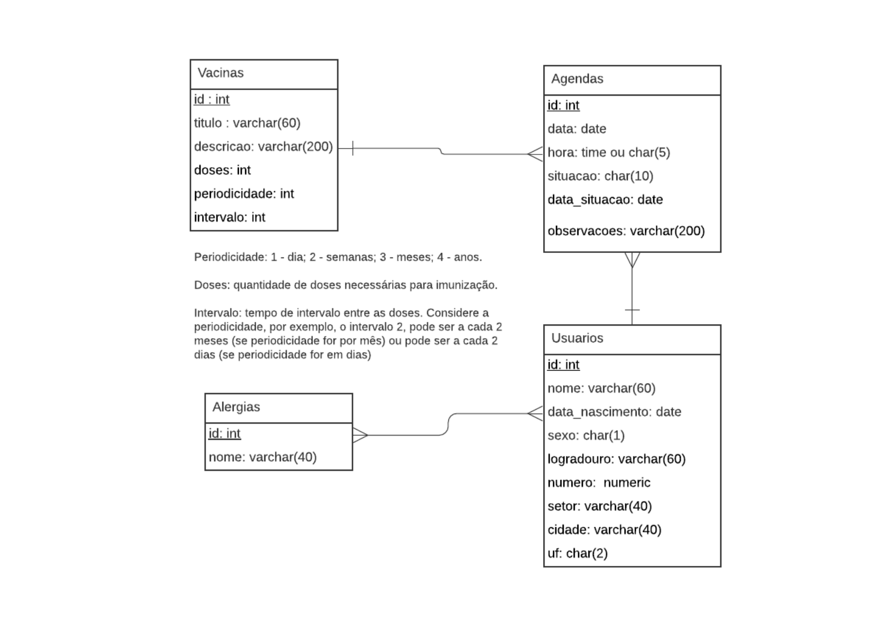

# Instruções do projeto — Agendamento de vacinas

## Contexto acadêmico

Este projeto reúne atividades de três matérias:

- Software para Persistência de Dados;
- Manutenção de Software;
- Implantação e Entrega de Software.

O enunciado abaixo foi transcrito da mensagem fornecida pelo responsável pelo projeto, preservando seus requisitos. O MER mencionado no enunciado está disponível em [imagem PNG](mer-vacinacao.png) e está reproduzido ao final deste documento. Consulte a imagem antes de definir ou alterar o modelo de dados. Se ela não estiver disponível, solicite-a ao responsável, sem inventar sua estrutura.

## Sobre o projeto

**Assunto: Agendamento de vacinas**

### Item 1

O sistema deve ter opção para CRUD de: vacinas, alergias, usuários e agendas;

- Entenda-se por "CRUD" apenas as opções de inclusão, exclusão e consulta (alteração é opcional). Consultar, significa uma tela para visualizar todas as informações cadastradas.

### Item 2

Listagens completas para todas as tabelas: Alergias, Vacinas, Usuários e Agendas (escolha as colunas que serão exibidas).

### Item 3

Listagem (ou opção de filtro) das agendas "Canceladas" e "Realizadas".

### Item 4

Lista das agenda do dia corrente (ou opção de filtro). Exibir primeiro as que estão com situação agendadas, em seguida as realizadas e, então, as canceladas.

### Item 5

Opção para "dar baixa" em uma agenda - dar baixa significa indicar a agenda como Realizada ou Cancelada. Use a data do dia para o campo data_situacao.

### Item 6

Acrescentar uma opção para visualizar os agendamentos do usuário (data, situação, vacina e dose). Elabore uma forma fácil de visualizar esta informação.

### Item 7

Proponha uma nova funcionalidade para a aplicação e a desenvolva. A descrição da funcionalidade deve ser entregue como um arquivo PDF a parte, no qual deve estar descrito a funcionalidade e o impacto na aplicação (mudanças na estrutura do banco, etc).

## Sobre as tabelas

### Tabela Vacinas

- **doses:** quantidade de doses a ser aplicada para a vacina ser efetiva. Campo obrigatório e inteiro.
- **periodicidade:** campo inteiro. Indica se o intervalo é medido em dias, semanas, meses ou anos. Este valor só tem sentido se o campo doses for maior do que 1.
- **intervalo:** intervalo de tempo entre as doses. Por exemplo, uma vacina com "3" doses e periodicidade mensal e intervalo "2" precisará ser aplicada por 3 vezes, sendo o intervalo entre uma vacinação e outro de "2 meses".

### Tabela Agendas

Representa os agendamentos realizados para aplicação das vacinas.

- **data:** data que a aplicação da vacina foi agendada.
- **situacao:** Agendado, Cancelado e Realizado. Obs: Na linguagem de programação (Java), utilize um ENUM para representar essas informações.
- **data_situacao:** Nulo, quando a agenda estiver com a situação "Agendado". Se o campo for "Cancelado" ou "Realizado", então esta data refere-se à data do cancelamento ou aplicação da vacina.

**Regra Importante:** sempre que uma vacinação for agendada é preciso considerar as informações de doses, periodicidade e intervalo da tabela vacinas, ou seja, se estivermos fazendo a agenda de uma vacina que possui 5 doses, com periodicidade anual e intervalo de 3, o sistema deverá, automaticamente, criar cinco agendas. A primeira agenda será para a data escolhida; a segunda para o mesmo dia/mês (se possível) e três anos à frente; a terceira/quarta/quinta para daqui a 6 anos, 9 anos e 12 anos.

### Tabela Usuários

São as pessoas que serão vacinadas (pacientes, clientes...).

- Ao cadastrar o usuário é preciso abrir a possibilidade para adicionar as possíveis alergias do usuário. Pode ser zero ou várias.
- **Campo sexo:** Masculino ou Feminino. Na tela deverá ser um combobox ou um rádio button.
- **Campo UF:** armazena uma das siglas dos vinte e seis estados e do distrito federal. Na tela deverá ser um combobox.

### Tabela Alergias

Cadastro simples de alergias.

## Informações

- Pode ser feito em dupla.
- Outras tecnologias podem ser utilizadas, desde que sejam explicadas no vídeo e/ou "leitame.txt"/"readme.md".
- Qualquer necessidade de adequação do modelo de dados precisa ser justificada e documentada (no arquivo texto).

## Entregáveis

- Código fonte do projeto.
- Vídeo explicando o funcionamento do projeto (no máximo 5 minutos) - deve constar o nome do(s) participante(s) no vídeo.
- Sugestão: poste o link para o vídeo em um arquivo chamado "video.txt". Se necessário, lembre-se de dar permissão de leitura ao vídeo para o usuário eliasferreira@ufg.br.
- Arquivo PDF separado com a descrição da funcionalidade adicional do Item 7 e seu impacto na aplicação, conforme exigido nesse item.

### Para aqueles que optarem em fazer em outra tecnologia

- Se usar outras tecnologias, entregar um arquivo do tipo texto explicando como executar o projeto.
- Manual com o passo-a-passo de instalação, configuração e execução do programa.
- Um documento em PDF com uma breve descrição (~5 páginas) do Framework de persistência utilizado.

## Avaliação

O vídeo e o projeto são avaliados:

- A desenvoltura, clareza e conhecimento ao apresentar as funcionalidades do vídeo;
- Funcionalidades desenvolvidas;
- Corretude de cada funcionalidade;
- Usabilidade do projeto.

## MER

Para o projeto, considere o banco de dados "vacinacao" representado no modelo de entidade e relacionamento abaixo.

Fonte: modelo fornecido pelo professor.
